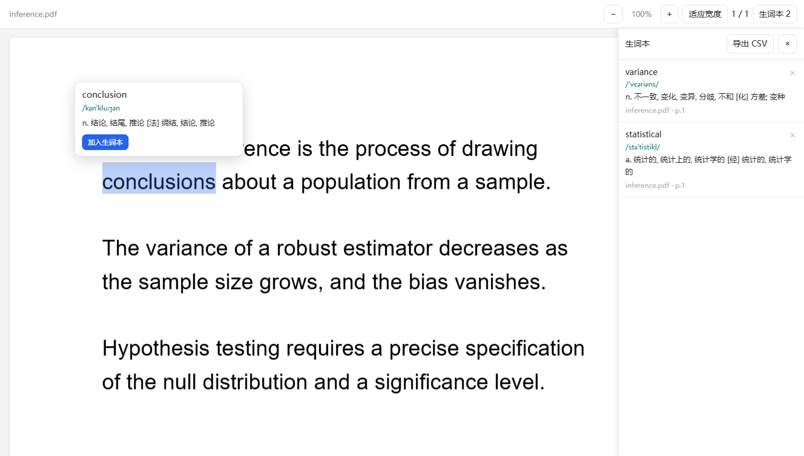

# 英文PDF阅读器

Chrome 扩展，支持在英文 PDF 上划词查词、划句翻译，记录生词。

读英文 PDF 时，查词、翻译、记录常常分散在三个程序中，需要反复切换窗口并手动复制粘贴，且无法溯回出处。  
本扩展将取词、翻译、收录合并进 PDF 阅读界面，无需切换程序，并自动记录每个生词来源，详细至文件名、页码。

## 功能

- **划词查词** —— 选中单词即显示音标与中文释义，内置 59111 条离线词库。自动识别单词变形，存入原词。
- **划句翻译** —— 选中整句或短语即显示中文译文，可与原文一并收录。
- **生词本** —— 单词与句子均可收录，并可导出 Excel（.xlsx）文件

阅读器界面：

生词本界面：支持搜索、按单词/句子筛选、单条删除、导出 Excel 与一键清空。

## 安装

1. 下载本仓库(Code → Download ZIP，或 `git clone`)
2. Chrome 右上角三个点 → 「拓展程序」→「管理拓展程序」，或地址栏输入 `chrome://extensions`
3. **打开右上角「开发者模式」**
4. 点击左上角「加载已解压的扩展程序」，拖入本文件夹

## 使用

| 操作           | 结果                          |
| ------------ | --------------------------- |
| 划选单词         | 显示音标与释义，可加入生词本              |
| 划选句子或短语      | 显示译文，可加入生词本                 |
| 鼠标悬浮「生词本」    | 弹出侧栏查看与删除                   |
| 点击侧栏右上角 ↗    | 在新标签页打开完整生词本页面              |
| 点击「导出 Excel」 | 导出全部生词到 .xlsx 表格            |
| 点击「退出扩展」     | 当前文件改用 Chrome 自带的 PDF 查看器打开 |
| 点击工具栏扩展图标    | 弹出面板，切换「打开 PDF 的方式」，并可跳转生词本 |

生词本页面支持搜索、按单词/句子筛选、单条删除、导出 Excel 与一键清空，与阅读器侧栏共用同一份数据。

## 注意事项

- 需要 Chrome 151 或更高版本。本扩展使用 Chrome 官方的 `chrome.mimeHandler` 接口，尚不支持 Edge 。
- **请勿移动或重命名扩展文件夹。** 开发者模式下扩展的标识由文件夹路径决定，路径变更后扩展仍可运行，但无法读取此前保存的生词。
- 查词使用离线词库，不联网。整句翻译调用在线接口，存在每日额度限制。
- 关闭该开关只是让扩展不再渲染页面，扩展本身仍处于启用状态。如需彻底停用，请在 `chrome://extensions` 中关闭。

## 数据存储

生词保存在 `chrome.storage.local`，写入本机磁盘。关闭浏览器、重启电脑、清除浏览数据均不会丢失。

卸载扩展或删除扩展文件夹会一并清除数据，建议定期导出 Excel 备份。

数据仅存于本机，不进行跨设备同步。

## 文件说明

| 文件                                         | 说明                   |
| ------------------------------------------ | -------------------- |
| `manifest.json`                            | 扩展清单                 |
| `viewer.html` / `viewer.css` / `viewer.js` | 阅读器界面与逻辑             |
| `vocab.html` / `vocab.css` / `vocab.js`    | 生词本页面                |
| `popup.html` / `popup.js`                  | 工具栏弹出面板              |
| `xlsx.js`                                  | xlsx 写入器，阅读器与生词本页面共用 |
| `sw.js`                                    | 后台脚本                 |
| `pdf.min.js` / `pdf.worker.min.js`         | PDF.js 3.11.174      |
| `dict.js`                                  | 离线英汉词库，59111 条       |
| `screenshot.png` / `screenshot-vocab.png`  | 界面截图                 |

## 更新日志

- 顶栏最右侧增加了「退出扩展」按钮。点击「退出扩展」，将当前文件在 Chrome 自带查看器中打开。
- 调整了「退出扩展」和「生词本」按钮的布局，防止用户误触。
- 增加了鼠标悬浮弹出生词本的功能，方便用户查看。
- 支持在原生查看器下点击扩展图标回到阅读器。
- 工具栏弹出面板新增开关，可控制打开 PDF 的默认方式。
- 新增独立生词本页面，支持搜索、筛选、单条删除、导出 Excel 与一键清空。

## 依赖与许可

- PDF.js —— Apache-2.0
- ECDICT —— MIT

---

> 作者：北斗惜风  
> 时间：2026/10
